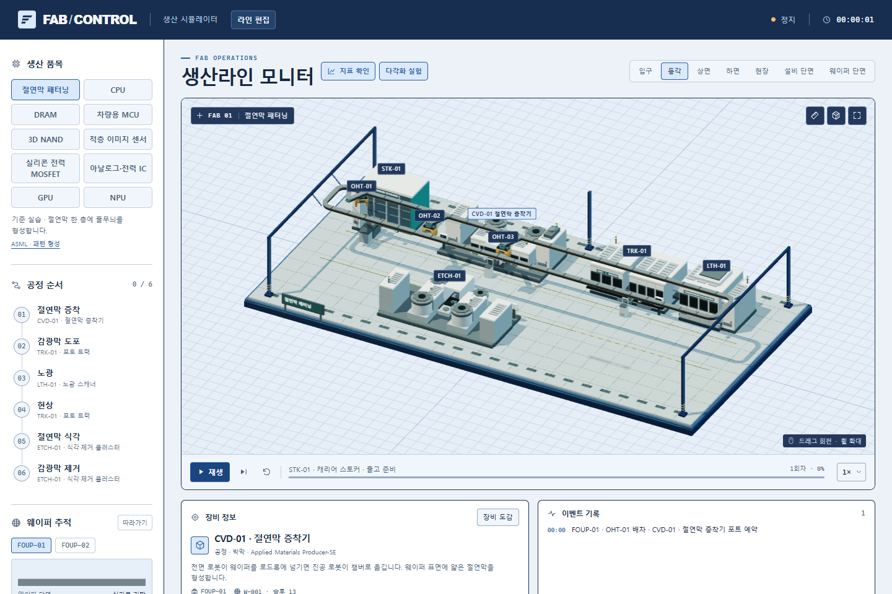

# FAB CONTROL

**300 mm 반도체 팹의 공정과 물류를 체험하는 3D 웹 시뮬레이터**입니다. 천장 운송차가 웨이퍼 용기(FOUP)를 장비 사이로 옮기는 모습과 장비 내부에서 웨이퍼 한 장이 가공되는 과정을 볼 수 있습니다.

<!-- Vercel 배포 후 여기에 실제 웹 데모 링크를 추가합니다. -->



## 주요 기능

- **10개 공정 시나리오** · 절연막 패터닝, CPU, DRAM, 차량용 MCU, 3D NAND, 적층 이미지 센서, 실리콘 전력 MOSFET, 아날로그·전력 IC, GPU, NPU를 전환합니다.
- **웨이퍼 추적과 식각 비교** · 장비 내부의 웨이퍼 이송을 따라가고, 기준 시간과 짧은 시간의 식각 결과를 단면에서 비교합니다.
- **라인 편집과 장비 도감** · 장비를 추가하거나 옮겨 편집한 라인을 운전합니다. 도감에서 장비 45종의 렌더 이미지와 GLB 모델을 확인할 수 있습니다.
- **생산 지표와 다각화 실험** · 처리량, 재공품, 운송 대기 등을 그래프로 확인합니다. 같은 투입 조건에서 OHT 우회, 버퍼, 혼류 생산, 챔버 배정, 장애 대응의 효과를 비교합니다. [실험 화면](docs/images/fab-experiment.png)
- **캠퍼스 운영** · GPU·NPU 주문의 입고 검수, 웨이퍼 팹, 조립·시험, 포장과 고객 인도를 3D에서 연결합니다. HBM 지연과 반품을 실행해 병목과 공급 로트를 추적할 수 있습니다. [캠퍼스 사용법](docs/SIMULATOR_GUIDE.md#캠퍼스-운영)

## 빠른 실행

Node.js 22.12 이상과 WebGL 2를 지원하는 브라우저가 필요합니다. 저장소를 내려받은 뒤 프로젝트 루트에서 실행하세요.

```sh
npm ci
npm run dev
```

터미널의 로컬 주소에서 **생산라인 모니터** 또는 **반도체 캠퍼스**를 선택합니다. 생산라인 모니터를 열면 기본 라인이 자동으로 운전합니다. `npm run build`로 배포용 파일을 `dist/`에 생성하고, `npm test`로 시뮬레이션을 검증할 수 있습니다.

## 프로젝트 문서

- [시뮬레이터 사용 및 검증 가이드](docs/SIMULATOR_GUIDE.md)
- [개발 체크리스트](<docs/개발 체크리스트.md>)
- [공정별 반도체 장비 도감](<docs/공정별 반도체 장비 도감.md>)
- [글로벌 반도체 팹 공개자료 조사](<docs/글로벌 반도체 팹 공개자료 조사.md>)
- [반도체 생산라인 다각화 연구](<docs/반도체 생산라인 다각화 연구.md>)
- [반도체 공급망과 공장 운영 조사](<docs/반도체 공급망과 공장 운영 조사.md>)

장비의 3D 형상은 공개 자료를 참고해 만든 교육용 개념 모델입니다. 배치, 공정 시간, 물류 조건의 가정과 출처는 [모델링 기준](fab-model-reference.json)과 [장비 검수 기록](assets/equipment/README.md)에 정리되어 있습니다.
